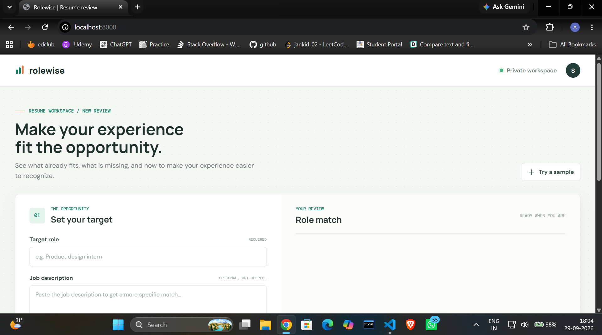

<div align="center">

# 🔍 Rolewise

**Make your experience fit the opportunity.**

A private, local-first **resume reviewer** for students and early-career applicants.
Paste your resume and a target role — get a match score, the gaps worth closing, and concrete ways to improve.

[](https://www.python.org/)
[](https://developer.mozilla.org/en-US/docs/Web/JavaScript)
[](#-quick-start)
[](https://openai.com/)
[](https://ai.google.dev/)
[](#-privacy)
[](#-contributing)

[Features](#-features) · [Quick Start](#-quick-start) · [AI Integration](#-ai-integration) · [API](#-api-endpoints) · [Roadmap](#️-roadmap)

</div>

## 🖼️ Preview
<p align="center">
  
</p>

## ✨ Features

| | Feature | Description |
|---|---|---|
| 🎯 | **Role detection** | Recognizes 7+ career tracks (frontend, software, data, product, UX, marketing, business) and tailors the keyword set to each |
| 📊 | **Match score** | Instant 0–100 gauge with a plain-language verdict |
| 🔍 | **Signal matching** | See exactly which role keywords your resume hits — and which ones are missing |
| 💡 | **Actionable recommendations** | Concrete, role-specific tips, including coaching toward result-driven bullet points |
| 📥 | **Resume import** | Paste text or import a `.txt` / `.md` file — no PDF parsing needed |
| 💾 | **Downloadable review** | Export the full review as a text file |
| 🧪 | **Try a sample** | One click fills the form with demo data so you can see a review immediately |
| 🤖 | **Optional AI upgrade** | Plug in OpenAI or Gemini for deeper, evidence-based feedback |
| 🧠 | **Offline fallback** | No API key? A local heuristic engine still runs the full review |
| 🔒 | **Private by design** | Everything runs on your machine — your resume is never uploaded or stored |

## 🚀 Quick Start

**Prerequisites:** [Python 3.8+](https://www.python.org/downloads/) — that's it. No `pip install`, no build step.

```bash
git clone <your-repo-url>
cd rolewise
python server.py   # or: python3 server.py
```

Then open **http://localhost:8000** in your browser.

> 💡 Use a different port with the `PORT` environment variable, e.g. `PORT=8080 python server.py`.

Without any AI keys configured, the app runs in **local heuristic mode** — fully functional, fully offline.

## 🤖 AI Integration

Optional: connect an AI provider for richer, model-generated reviews. Create a `.env` file in the project root with **one** of these:

**OpenAI**
```env
AI_PROVIDER=openai
OPENAI_API_KEY=your_key_here
OPENAI_MODEL=gpt-4o-mini
```

**Gemini**
```env
AI_PROVIDER=gemini
GEMINI_API_KEY=your_key_here
GEMINI_MODEL=gemini-2.0-flash
```

<details>
<summary>Alternative: configure via <code>config.json</code></summary>

```json
{
  "provider": "openai",
  "model": "gpt-4o-mini",
  "apiKey": "your_key_here"
}
```

The server also accepts the same settings through `POST /api/config`.
</details>

If an AI call fails or returns an unusable response, the server **automatically falls back** to the local heuristic engine — the review always comes back.

## 🧠 How Local Mode Works

- Your target role (and optional job description) is matched against one of seven built-in career-track keyword sets.
- Your resume text is scanned for those role signals — found vs. missing skills are listed separately.
- Heuristics check for impact verbs and standard resume sections to generate improvement tips.
- Everything happens in one Python file with zero external services.

## 📡 API Endpoints

| Method | Endpoint | Description |
|---|---|---|
| `GET` | `/api/health` | Server status and active provider |
| `GET` | `/api/config` | Current AI provider configuration |
| `POST` | `/api/config` | Save provider, model, and API key |
| `POST` | `/api/analyze` | Run the resume review (role + optional job description + resume) |

## 📁 Project Structure

```
├── app.js        # Frontend logic (vanilla JS)
├── index.html    # Single-page UI
├── styles.css    # Styling
├── server.py     # Python stdlib server + review engine
├── config.json   # Runtime AI config (auto-managed)
├── docs/screenshot.png  # App screenshot (used in this README)
└── .env          # Optional AI keys (not committed)
```

## 🔒 Privacy

- The app runs entirely on `localhost` — there is no analytics, tracking, or telemetry.
- Reviews are not stored anywhere; closing the tab clears everything.
- In AI mode, the resume text is sent only to the provider you configure (OpenAI or Gemini). In local mode, nothing ever leaves your machine.

## 🗺️ Roadmap

- [ ] PDF / DOCX resume import
- [ ] In-app settings panel for AI provider configuration
- [ ] Side-by-side comparison of resume versions
- [ ] Dockerfile for one-command deployment
- [ ] Automated tests for the review engine

## 🤝 Contributing

Issues and pull requests are welcome! Keep PRs small and focused — this project intentionally stays dependency-free.

## 📄 License

> ⚠️ Not yet licensed — add a `LICENSE` file (e.g. [MIT](https://choosealicense.com/licenses/mit/)) before making this repository public.

---

<div align="center">
<sub>Built with plain Python and vanilla JavaScript — no frameworks, no build step.</sub>
</div>
